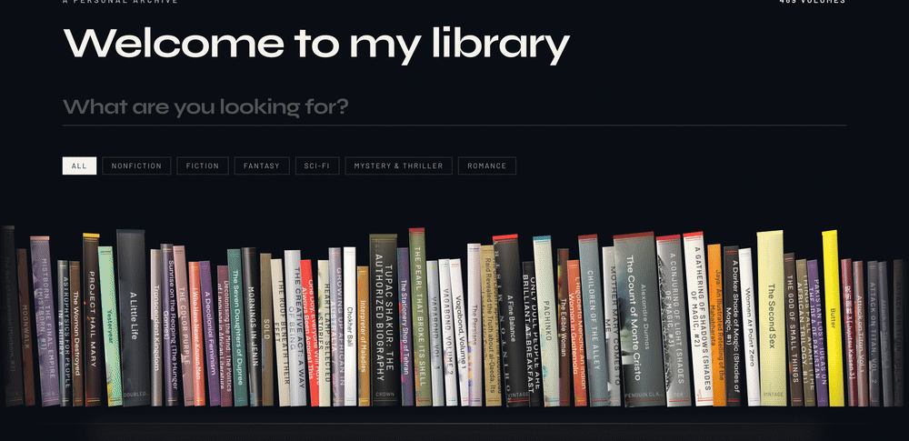

# Welcome to my library

This is my collection: all the books I've read. Pick a category and they're sorted A–Z by author. Click a book to read a short description.



## Run it

```bash
npm install
npm run dev
```

Then open [http://localhost:5173](http://localhost:5173).

## Use your own books

1. On Goodreads, go to **My Books → Import and export → Export Library**.
2. Download `goodreads_library_export.csv` from the email.
3. Import that file. This replaces the shelf with the books you have marked read or currently reading, including your star ratings.

```bash
npx tsx scripts/import-goodreads.ts path/to/goodreads_library_export.csv
```
